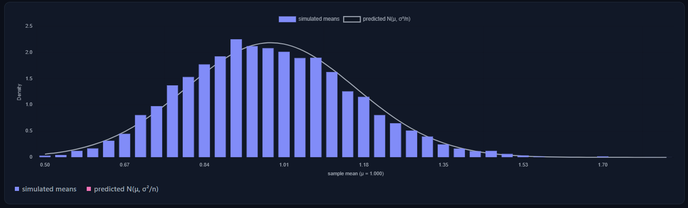
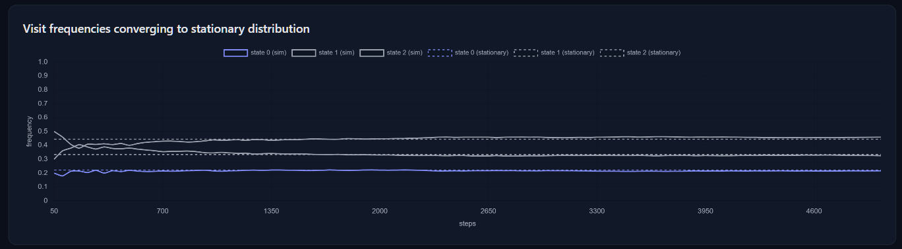
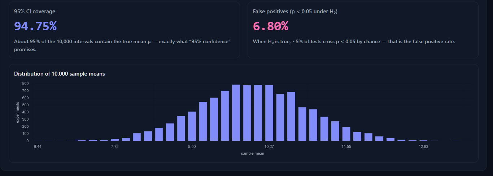

# Stochastic — Interactive Probability Simulator

An interactive probability simulator built with Vite, React, and TypeScript.
Explore randomness, sampling, and inference through hands-on visual
experiments. Each lab contrasts **simulation** with **exact theory** and shows
convergence as the sample size grows.

## Labs

| Lab | What it does |
| --- | --- |
| **Week 1 — CLT & Law of Large Numbers** | Pick a distribution, sample size `n`, and number of trials. Watch the histogram of sample means converge to the theoretical normal curve, plus a running-mean view of the law of large numbers. |
| **Week 2 — Monte Carlo** | Estimate π by scattering points in a square, explore the birthday paradox and Monty Hall (simulated vs. exact), and watch the error shrink like `1/√n`. |
| **Week 3 — Markov Chains** | Edit a transition matrix, simulate walks, compute the stationary distribution, and run a mini PageRank. |
| **Week 4 — Bayes & Hypothesis Testing** | Update a posterior live from priors and likelihoods (medical test example) and simulate 10,000 experiments to see what p-values and 95% confidence intervals really mean. |

## Screenshots






## Tech stack

- Vite + React 19 + TypeScript
- Chart.js / react-chartjs-2
- ESLint (flat config)

## Getting started

```bash
npm install
npm run dev
```

Open http://localhost:5173

## Build (production)

```bash
npm run build
npm run preview
```

The production bundle is emitted to `dist/`.

## Deploy

`dist/` is a static site — deploy it to GitHub Pages, Vercel, Netlify, or Cloudflare Pages.

## License

MIT — see [LICENSE](LICENSE).